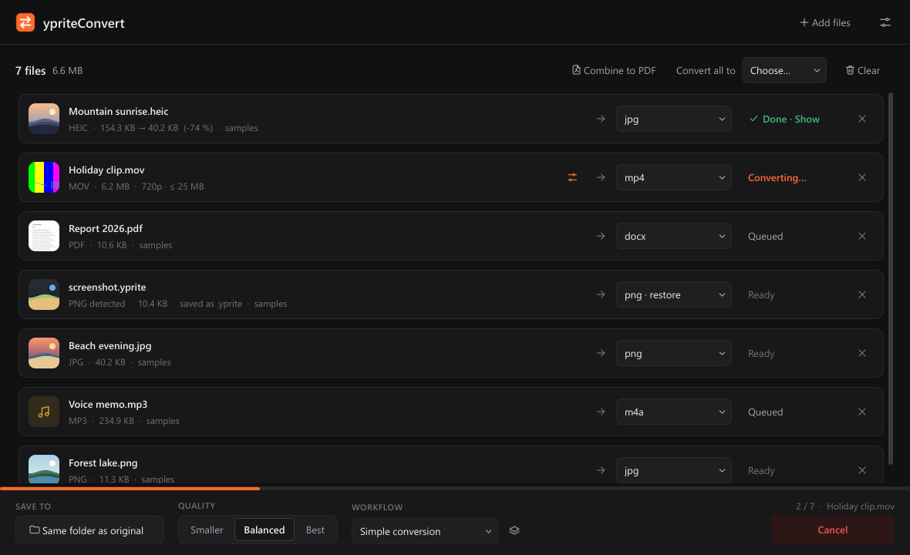
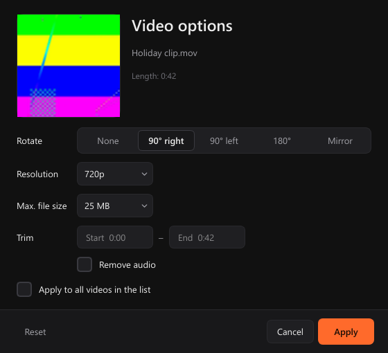
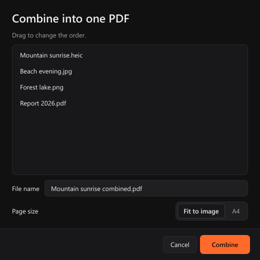
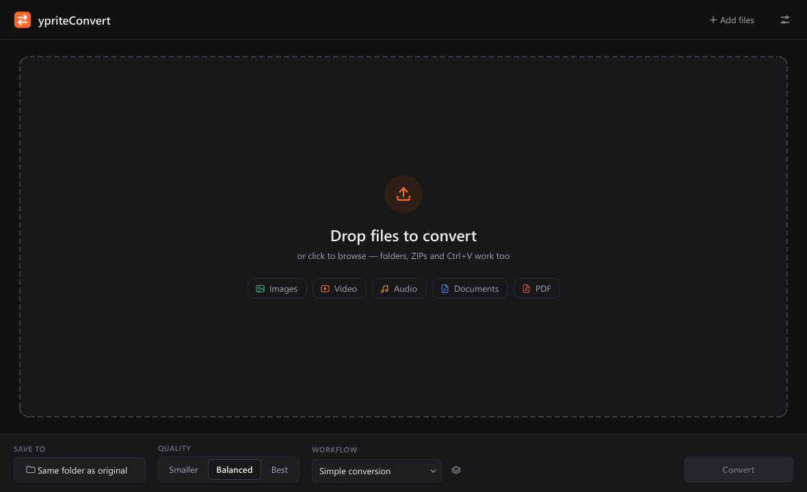
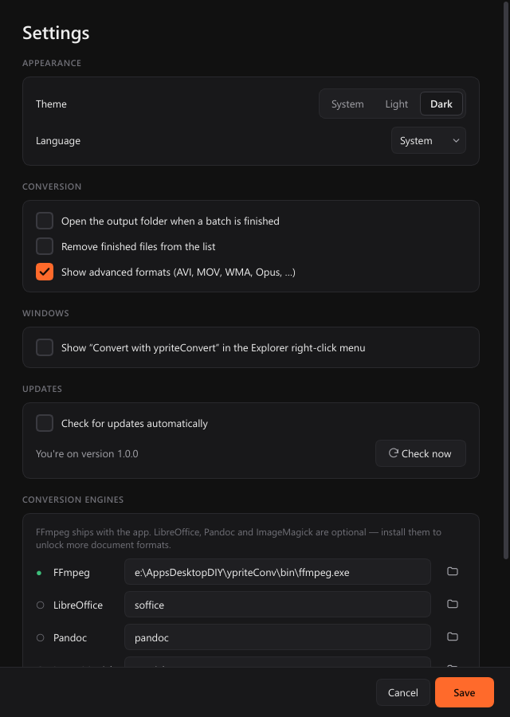

<p align="center">
  
</p>

<h1 align="center">ypriteConvert</h1>

<p align="center">
  A fast, private file converter for Windows.<br>
  Images, video, audio, documents and PDFs, converted right on your PC. Nothing is uploaded.
</p>

<p align="center">
  <a href="https://github.com/theStxve/ypriteConv/releases/latest"></a>
  <a href="https://github.com/theStxve/ypriteConv/releases"></a>
  <a href="https://github.com/theStxve/ypriteConv/actions/workflows/release.yml"></a>
  
  
  
  
</p>

<p align="center">
  <a href="https://github.com/theStxve/ypriteConv/releases/latest"><b>Download for Windows</b></a>
  &nbsp;·&nbsp;
  <a href="#features">Features</a>
  &nbsp;·&nbsp;
  <a href="#command-line">Command line</a>
  &nbsp;·&nbsp;
  <a href="CHANGELOG.md">Changelog</a>
</p>

<p align="center">
  <picture>
    <source media="(prefers-color-scheme: dark)" srcset="docs/screenshots/main_dark.png">
    <source media="(prefers-color-scheme: light)" srcset="docs/screenshots/main_light.png">
    
  </picture>
</p>

## Features

| | |
| --- | --- |
| **Images** | JPG, PNG, WebP, HEIC (iPhone), TIFF, GIF, BMP, ICO. Keeps EXIF, fixes photo rotation, keeps animations. |
| **Video** | MP4, MKV, WebM, MOV, AVI and more. Rotate, trim, change the resolution, remove audio, or hit a target file size (for example "under 25 MB" for Discord). Video can also become MP3, M4A, WAV or GIF. |
| **Audio** | MP3, WAV, FLAC, AAC, OGG, M4A, Opus. |
| **PDF** | PDF to Word, text or images (every page, up to 300 DPI). Combine images and PDFs into one PDF, or split a PDF into pages. |
| **Documents** | DOCX, ODT, RTF, Markdown, HTML, TXT (with LibreOffice or Pandoc installed). |
| **Real file type detection** | Recognizes files by their content, not their name. `photo.yprite`, `clip.xyz` or an iPhone photo saved as `.jpg` are still identified, and you can restore the correct extension without re-encoding. |
| **Fast** | Converts several files at once and shows thumbnails, the size before and after, and progress in the taskbar. |
| **Workflows** | Multi-step presets such as *Podcast Publisher* (extract audio, normalize to -16 LUFS, MP3), plus a builder for your own. |
| **Windows integration** | Right-click "Convert with ypriteConvert" in Explorer, paste with Ctrl+V, light and dark mode, English and German. |
| **Automatic updates** | Updates install in the background from GitHub Releases, verified by checksum. |

<table>
  <tr>
    <td width="50%"><p align="center"><sub>Video options: rotate, resize, trim, target size</sub></p></td>
    <td width="50%"><p align="center"><sub>Combine images and PDFs into one PDF</sub></p></td>
  </tr>
  <tr>
    <td width="50%"><p align="center"><sub>Drop files, folders or ZIPs, or paste them</sub></p></td>
    <td width="50%"><p align="center"><sub>Settings</sub></p></td>
  </tr>
</table>

## Install

1. Download `ypriteConvert-Setup-x.y.z.exe` from the [latest release](https://github.com/theStxve/ypriteConv/releases/latest).
2. Run it. It installs for the current user, so no admin rights are needed.

FFmpeg is included. For document conversions (for example DOCX to PDF), you can also install
[LibreOffice](https://www.libreoffice.org/) or [Pandoc](https://pandoc.org/). The app finds them automatically.

> Windows SmartScreen may warn about an unknown publisher because the installer isn't code-signed.
> Click **More info**, then **Run anyway**.

## Command line

The installed `ypriteConvert.exe` also works from a terminal:

```bat
ypriteConvert.exe -i video.mp4 --to mp3 --quality high
ypriteConvert.exe --batch "C:\Photos\*.heic" --to jpg -o C:\Converted
ypriteConvert.exe -i interview.mov --preset "Podcast Publisher"
ypriteConvert.exe --list-presets
```

## Keyboard shortcuts

| Shortcut | Action |
| --- | --- |
| `Ctrl+O` | Add files |
| `Ctrl+V` | Paste files or an image |
| `Ctrl+Enter` | Start converting |
| `Delete` | Remove selected files |
| `Ctrl+,` | Settings |

## Development

```bat
python -m venv .venv
.venv\Scripts\pip install -r requirements.txt
.venv\Scripts\python main.py
```

| Path | Purpose |
| --- | --- |
| `app_info.py` | Name, version, GitHub repository |
| `ui/` | Qt interface. `theme.py` holds all colors and styles, `i18n.py` the German translations |
| `converters/` | Image, video and audio (FFmpeg), document and PDF converters |
| `modules/file_detect.py` | Content-based file type detection |
| `modules/updater.py` | Auto-updater using GitHub Releases |
| `pipeline_steps/`, `presets/` | Workflow system and built-in workflows |
| `installer/ypriteConvert.iss` | Inno Setup installer |

### Build

```bat
build.bat            :: dist\ypriteConvert\ and Output\ypriteConvert-Setup-<version>.exe
build.bat 1.2.0      :: same, after setting the version
```

Building the installer requires [Inno Setup 6](https://jrsoftware.org/isinfo.php) (`winget install JRSoftware.InnoSetup`).
The build script takes FFmpeg from your PATH or downloads it.

### Release

1. Add a section for the new version to `CHANGELOG.md`.
2. Tag and push it: `git tag v1.2.0 && git push origin v1.2.0`
3. The GitHub Action builds the installer and publishes the release.
   Installed apps offer the update and show the changelog after updating.

## Credits

Built with [PyQt6](https://www.riverbankcomputing.com/software/pyqt/), [FFmpeg](https://ffmpeg.org/),
[PyMuPDF](https://pymupdf.readthedocs.io/), [pdf2docx](https://github.com/ArtifexSoftware/pdf2docx),
[Pillow](https://python-pillow.org/), [pillow-heif](https://github.com/bigcat88/pillow_heif) and
[pikepdf](https://github.com/pikepdf/pikepdf).
